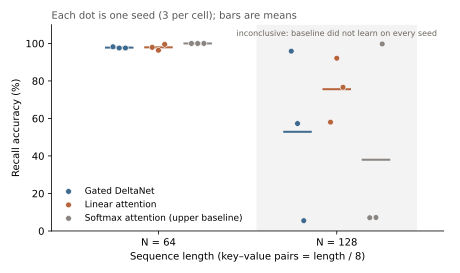

# Replicate SOTA

> **Work in progress.** The rebuild is verified. The recall experiment is done: a tie at length 64, inconclusive at 128.

Rebuild a current open-weights model from scratch, prove the rebuild matches the official one at every position, test its key new idea in a small experiment, and explain it all.

**v1:** [Qwen3.5-0.8B](https://huggingface.co/Qwen/Qwen3.5-0.8B) (Apache 2.0, Feb 2026). It is a hybrid model: 18 Gated DeltaNet layers (linear attention with a fixed-size memory) and 6 ordinary attention layers, in a repeating 3 : 1 pattern.

## Result so far

**The from-scratch rebuild matches the official model on all 8 test prompts.** The largest difference in any next-token score, at any position, is **3.8×10⁻⁵**, against a threshold of 10⁻⁴. That threshold was first fixed at 10⁻³ before running, then tightened once the measured gap proved far smaller (5.3×10⁻⁵ on the first, local run). The top token agrees at 100% of positions, and every 32-token greedy continuation is identical.

| Prompt | Tokens | Largest score gap | Same top token | Greedy 32 |
|---|---:|---:|---:|---|
| one token | 1 | 2.1×10⁻⁵ | 100% | same |
| english | 18 | 1.4×10⁻⁵ | 100% | same |
| code | 27 | 1.6×10⁻⁵ | 100% | same |
| chinese | 14 | 1.3×10⁻⁵ | 100% | same |
| emoji | 32 | 1.8×10⁻⁵ | 100% | same |
| repeated | 121 | 1.6×10⁻⁵ | 100% | same |
| long 1k | 1,042 | 2.9×10⁻⁵ | 100% | same |
| long 4k | 4,534 | 3.8×10⁻⁵ | 100% | same |

The reference is official `transformers` 5.22.2 on PyTorch 2.15 (CPU, run in GitHub Actions). Ours runs on PyTorch 2.2.2, so the match holds across versions. Source: [`results/verify.json`](results/verify.json).

## Recall experiment

**Question.** Gated DeltaNet *corrects* its memory: it writes only the part of a new value that the memory gets wrong. Plain linear attention just adds every new value on top. Does correcting help a layer recall key–value pairs?

**Method.** Multi-query associative recall (MQAR, from Zoology, Arora et al. 2023). Each model is two layers deep, 0.17M parameters, width 64, vocabulary 512. Training runs 1,500 steps on CPU. There are 3 seeds per cell, and length/8 key–value pairs per sequence. Hypothesis, fixed before running: Gated DeltaNet beats linear attention at every length, by more than the seed spread.

| Layer | N = 64 | N = 128 (inconclusive) |
|---|---|---|
| Gated DeltaNet | **97.8%** ± 0.4 (98.2, 97.5, 97.5) | 52.9% ± 45.4 (95.9, 57.3, 5.5) |
| Linear attention | **97.9%** ± 1.6 (97.9, 96.4, 99.5) | 75.6% ± 17.1 (58.0, 92.1, 76.6) |
| Softmax attention | **100%** ± 0.0 | 38.0% ± 53.5 (7.1, 7.2, 99.7) |

± is the sample standard deviation over 3 seeds.

**Result.**
- **N = 64: a tie.** Gated DeltaNet trails linear attention by 0.2 points, well inside the seed spread. The hypothesis is not supported at this length.
- **N = 128: inconclusive.** Softmax can look back at every earlier token, so it can solve this task. Yet it learned it on only 1 of 3 seeds. The runs are all-or-nothing within 1,500 steps, so these averages measure how fast training takes off, not how much the memory holds.
- The rule "a length counts only if softmax reaches ≥ 90% on every seed" was added *after* seeing the results.

**Limits.**
- These models are tiny, with a single learning rate (3×10⁻³), and the task vocabulary is smaller than Zoology's.
- Both linear mixers get Qwen's 4-token convolution. It was added after a pilot in which neither could learn without it.
- This tests one claim on one toy task. It is not the papers' benchmark.
- Next: rerun N = 128 with about 4,000 steps, then N = 256.

Source: [`results/recall.json`](results/recall.json). Reproduce: `python -m experiments.recall.run` (about 8–10 h on an Intel i9 CPU).

## Docs

- [How to set up and run](docs/INSTRUCTIONS.md)
- [System design](docs/SYSTEM-DESIGN.md)
- [What's where](docs/FILE-STRUCTURE.md)
- [Prompt log](docs/PROMPTS.md)
