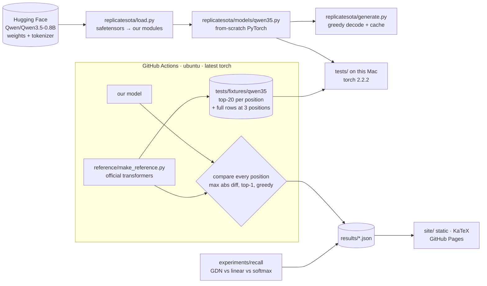

# System Design

**Status:** v1 in progress (2026-11-11). Model: Qwen3.5-0.8B, text path only. The rebuild matches the official model on all 8 prompts (worst score gap 5.3×10⁻⁵). Recall experiment done: a tie at length 64; length 128 is inconclusive (the softmax baseline learned it on only 1 of 3 seeds).

## What this is

Replicate SOTA rebuilds a current open-weights model from scratch, proves the rebuild is exact, runs one small experiment on the model's new idea, and explains it all on a static website.

v1 covers one model. The goal that wins any conflict is the builder understanding the model deeply (see the spec, OPEN QUESTIONS).

## Architecture

## Components

| Piece | Job | Depends on |
|---|---|---|
| `replicatesota/models/qwen35.py` | The model: RMSNorm (zero-centred), partial RoPE, gated attention (GQA), Gated DeltaNet, SwiGLU MLP, hybrid 3:1 stack. Plain torch only, and nothing in it imports `transformers`. | torch ≥ 2.2 |
| `replicatesota/load.py` | Maps checkpoint names (`model.language_model.*`) onto our modules and upcasts the bf16 weights to fp32. | safetensors, huggingface_hub |
| `replicatesota/generate.py` | Greedy generation with a cache: a growing key/value cache for the attention layers, and a fixed-size conv + recurrent state for the DeltaNet layers. | model |
| `reference/make_reference.py` | Runs the **official** model on `reference/prompts.json` (CI only). Writes the fixtures and the full comparison report. | transformers (pinned) |
| `tests/` | Logit match against the fixtures, greedy match, and unit tests (recurrent vs chunked equivalence, RoPE, norms). | pytest |
| `experiments/recall/` | Associative-recall training on CPU: 3 layer types × 2 lengths × 3 seeds. One command regenerates the results and figure. | torch, matplotlib |
| `site/` | Static explainer site. Its numbers are read from `results/*.json` at build time, never typed by hand. | KaTeX via CDN, a small build script |

Each piece talks to the others through files (weights, fixtures, `results/*.json`) or one small function (`load_model`, `forward`, `generate`). Any one of them can be swapped without touching the rest. For example, a second model is a new `models/<name>.py` plus `reference/` prompts.

## Main flows

1. **Verify (CI).** Push → the Actions job installs pinned transformers and the latest torch, downloads the weights (cached) and runs the reference and our model in fp32 on 8 prompts. It compares hidden states and logits in chunks of positions, so the 4k × 248k logits are never held in memory at once. It uploads `results/verify.json` and the fixtures.
2. **Verify (local).** `pytest` loads the fixtures and our model on torch 2.2.2 (the last Intel-Mac wheel), and checks top-20 values, top-1 tokens, full rows at 3 positions, and the greedy continuation.
3. **Experiment.** `python -m experiments.recall.run` → `results/recall.json` + `site/assets/recall.svg`.
4. **Site.** `python site/build.py` fills the templates from `results/`, then GitHub Pages serves `site/`.

## Where data lives

- Weights: the Hugging Face cache on this machine (~1.7 GB) and the Actions cache. They are never committed.
- Fixtures: `tests/fixtures/qwen35/` (a few MB, committed). Each one records the transformers/torch versions and the commit that made it.
- Results: `results/*.json` (committed, small).
- No user data and no accounts. The site is static with no analytics, cookies or forms.

## Key decisions and trade-offs

- **Logit match as the definition of "replicated".** It is pass/fail and hard to fake. It proves the architecture and the weight mapping are right. It does not prove understanding, which is why v1 also includes the training experiment (the user's reason: "matching = copied math").
- **Where the reference runs.** PyTorch publishes no wheels newer than 2.2.2 for Intel Macs (checked 2026-11-11), and current transformers needs newer. The plan was CI, but GitHub Actions failed to start on this account. So the reference runs in a separate conda-forge env on this Mac (`.conda-ref/`: PyTorch 2.7.1, transformers 5.22.2), which conda-forge still builds for Intel Macs. That keeps two environments: ours on 2.2.2 and the official code on 2.7.1. That's a stronger test, because the match holds across PyTorch versions. The CI workflow is kept and will run when Actions works.
- **Compare in CI, store compact fixtures.** Full logits for a 4k prompt are ~4 GB, so we store the top-20 per position plus 3 full rows. The local test is therefore slightly weaker than the CI test, which compares everything.
- **Tolerance 1e-4.** It was first set at 1e-3, because different CPUs and torch versions accumulate rounding differently over 24 layers. The first run measured a worst gap of 5.3e-5, so it was tightened to 1e-4 (2026-11-11). That still leaves ~2× headroom for rounding across machines.
- **Recurrent DeltaNet form first.** It is the readable definition, one token at a time. The chunked form (the fast, parallel training form) is implemented too, but only as a test that the two forms agree. That matters because the reference uses chunked for prefill.
- **Text path only.** The vision encoder and the multi-token-prediction head are deferred. Their weights are skipped at load time.

## How it's tested

- Unit tests: norms, RoPE, recurrent ≡ chunked Gated DeltaNet on random inputs (≤ 1e-5), and that the cached decode gives the same outputs as a full forward pass.
- Integration: the logit match (local fixtures and full CI comparison) and the greedy match.
- Experiment: a fixed seed list; the result is reported whatever it shows.

## Threat model (small)

This is a static site and a public repo with no user data. The risks are supply chain and secrets:
- Pin the dependencies.
- Use only the Hugging Face weights, loaded via `safetensors` (no pickle).
- No `trust_remote_code`.
- CI uses no secrets (the Hugging Face model is public).
- The site loads KaTeX from a pinned CDN version with SRI hashes.

## Scale: what changes and when

- One model on CPU is fine today.
- Models over ~8B would not fit in fp32 in 32 GB of RAM or a 16 GB CI runner. They would need bf16 comparison (with a looser tolerance), larger runners, or comparing layer by layer.
- More models: the `models/<name>.py` + `reference/prompts` pattern already supports this. A repeatable pipeline would sit on top (deferred).

## Next ten steps (beyond v1, not built now)

1. Chunked GDN as the default prefill path, plus speed profiling.
2. MTP head (speculative decoding demo).
3. Vision encoder.
4. TinyStories hybrid-ratio ablation.
5. Second model (e.g. LFM3: conv + sliding-window attention).
6. Shared `common/` layers once two models use them.
7. Model-agnostic reference harness.
8. A rented-GPU option (budget asked first).
9. Site section per model with a shared template.
10. A "pipeline" CLI: `replicate new <hf-id>`.

The current layout keeps 5–10 easy: per-model files, results as JSON, and a site that is templated from results.

## Known limits

- Speed: about 2 tokens/s on a 2019 Intel i9. Prefill uses the chunked DeltaNet form, and decoding uses the step-by-step form.
- Local fixtures check the top-20 scores per position plus the full row at the last position. Only `make_reference.py` compares every score at every position.
- The recall experiment is small (0.17M-parameter models, 1,500 steps, lengths 64/128). It shows a direction, not the papers' numbers.
- GitHub Actions does not run yet (account-side startup failure), so nothing re-checks the match automatically on push.
